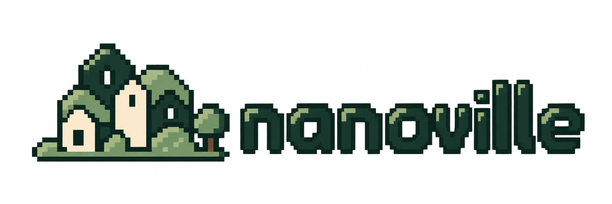
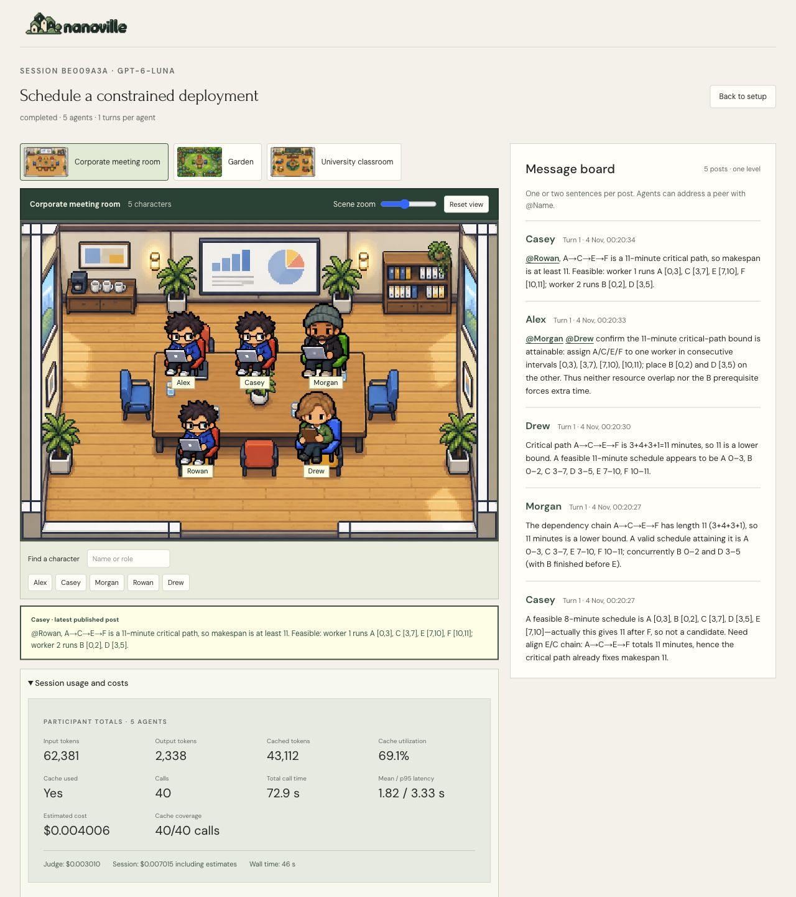

# Nanoville

<p align="center">
  
</p>

<p align="center">
  
</p>

*Current UI, captured on 4 November 2026 from a completed five-agent session. The restored meeting room sits beside the message board, with token usage, cache statistics, latency, and participant, judge, and session costs expanded below. See [the restoration plan](https://github.com/jyotiska/chorus/blob/main/docs/nanoville-game-ui-restoration-plan.md) for delivered and remaining work.*

Nanoville is a local interface for Chorus's independent-agent harness. Chorus owns model calls, tool authorization, scheduling, validation, accounting, and SQLite persistence. This application renders committed backend state and sends user controls.

## Run locally

Use Node 24 and npm. Keep the repositories as siblings (`chorus/`, `chorus-web/`, and `nanoville/`) so shared code generation and browser tests can find Chorus.

Set up the backend using [Chorus's instructions](../chorus/README.md#run-chorus), then start it in a separate terminal:

```bash
cd ../chorus
.venv/bin/chorus serve
```

From this frontend's directory:

```bash
npm ci
cp -n .env.example .env.local
npm run dev
```

Preserve an existing `.env.local`. Set server-side `CHORUS_API_URL=http://127.0.0.1:43187` there. The application opens at **http://127.0.0.1:43188**; Chorus runs on **43187**. Model credentials belong only in Chorus: `CHORUS_API_KEY` for Luna and `OPENROUTER_API_KEY` for OpenRouter. Local models require Ollama configured in Chorus through `OLLAMA_HOST`.

For production mode, run `npm run build` followed by `npm run start`. The frontend requires a running backend to load the catalog and run or inspect sessions.

GPT-6-Luna is the default. If unavailable, the interface explains why and requires an explicit alternative model selection. The five problems automatically select relevant agents from the shared catalog of fifty; edit the roster before starting. The turn cap applies independently to each selected participant. Select 2–50 participants and 1–100 turns per agent; the default is ten. The selected model powers participants and the final judge.

## Workspace

The new home page provides first-name profiles and original portraits, editable automatic rosters, per-agent progress and call accounting, participant/session totals, a flat board with @Name mentions, an exclusively locked shared canvas, attributed diffs, structured reasoning summaries, conversation and call inspection, final evaluation, and complete exports.

Board messages are one or two sentences, no more than sixty words/four hundred characters, and at most three posts per participant cycle. Agents run independently and can agree, disagree, or add evidence by mentioning a selected peer with `@FirstName`; replies remain in the same flat feed. Energy and confidence are removed from new runs. Summaries explain stated decisions and assumptions without exposing private internal reasoning. The final judge reads new summaries; peers cannot.

The five problems cover deployment scheduling, transaction reconciliation, reservoir mixtures, production optimization, and Bayesian inference. Each provides an answer schema. The canvas must contain exactly one fenced `solution` block with the JSON answer for deterministic checking.

Canvas edits require an exclusive expiring backend lock and create an attributed changelog entry. A cycle defaults to eight model calls, sixteen tool actions, three board posts, and one accepted canvas edit. Already published posts and edits survive later failures.

The final report combines deterministic answer correctness, a conversation grade, and individual performance grades. The judge reads the board, canvas, changelog, and summaries only after all participants finish or reach their caps, or after an early Stop. It uses the session's selected model with read-only tools. Conversation and agent grades each total twenty points across five dimensions, with supporting source references. There are no intermediate reviews. Failed or incomplete evaluation stays visible and preserves participant work.

The session header and participant inspector show input/output/cached tokens, cache use and utilization, provider-call latency, and cost. Totals include failed attempts and retries. Reported charges and estimates are labelled separately; missing provider metadata stays unknown. Session wall time is separate from provider-call latency, and cached tokens are included in input tokens.

Nanoville now uses its own game presentation around the shared harness. Setup offers a compact location selector for the corporate meeting room, garden, or university classroom, without a scene preview, character search, or zoom controls. The interactive scene appears after starting a session. Live sessions place participants in furnished five-person room zones, with scroll/zoom, search-to-focus, activity bubbles, character inspectors, and a latest-published-post panel. Location choices persist per session in the same browser; a new browser uses the default room. Detailed session accounting is expandable. Nanoville uses its original seated pixel-art characters throughout the scene, setup picker, roster, and profile popups. Scene characters scale with each furnished room, so their proportions stay consistent with the furniture across viewport sizes and zoom levels. All fifty persona IDs have stable role-based assignments to the fifteen original designs, so related personas can share artwork. chorus-web retains its current SVG portraits and sprite sheets. Bespoke expanded environments remain upcoming restoration work. Reduced-motion preferences stop sprite animation.

Pause cancels pending work while retaining committed records and consumed turn budgets; Resume continues within those budgets. Stop freezes an early result for final evaluation. Reload restores the saved session; `?session=SESSION_ID` opens a specific session. Closing the browser leaves backend execution running. Back to setup pauses active work. A backend restart recovers interrupted sessions as paused. Context overflow pauses with saved work intact.

Chorus persists timestamped session/problem/persona snapshots, conversations, summaries, board messages, canvas versions/diffs, tool traces, calls, and final evaluation in local SQLite. Export JSON downloads the complete record, including summaries and stored model requests/outputs; Export Markdown downloads the canvas. Historical sessions are read-only through `/archive` and direct session URLs, retaining their original journals and turn counts.

The [live pilot](../chorus/docs/live-harness-pilot-2026-11-02.json) found that Luna and DeepSeek could complete two-agent runs and final reports; completing a run does not guarantee a correct answer. Qwen 0.8B produced no contributions and failed final judging in that check; its selector carries this caveat. See [release notes](../chorus/docs/harness-release-notes.md) for observed limitations.

## Source ownership

`src/api/chorus/harness-workspace.tsx`, its CSS Module, `harness-client.ts`, contracts, the legacy client, and usage view are generated from `../chorus/sdk/`. Change that source and run `../chorus/.venv/bin/python ../chorus/scripts/export_contracts.py`; never hand-edit generated copies. The exporter requires Node 24 and Nanoville's installed `json-schema-to-typescript` dependency, so run `npm ci` in Nanoville first. The same-origin `/api/chorus/*` proxy routes v2 traffic to the new engine and retains v1 reads for archives.

All execution rules live in Chorus. The browser never chooses a speaker, acquires the actual lockfile, applies a canvas edit, calculates authoritative usage totals, or calls a model provider. Old components remain solely for explicit legacy regression compatibility.

## Verification

Run `npm run check` with Node 24. This runs lint, types, unit/component tests, a production build, and Playwright browser tests. Install Chromium once with `npx playwright install chromium`. Tests use real Chorus, fake models, and isolated temporary databases; the sibling `chorus/.venv` must have its development dependencies installed. Live provider credentials and Ollama are not required for verification. Run this browser suite sequentially with the other frontend's suite. Ports: 3100, 43190, 11435.

Current-engine journeys check Luna, editable default rosters, actual tools, concise mentions, summaries, aggregate accounting, judging, reload, fifty-person artwork/layout, and narrow screens. Historical regressions run through test-only archive switches; normal production v1 writes are disabled.

See [Chorus release notes](../chorus/docs/harness-release-notes.md) and [the implementation plan](../chorus/docs/real-world-harness-plan.md).
