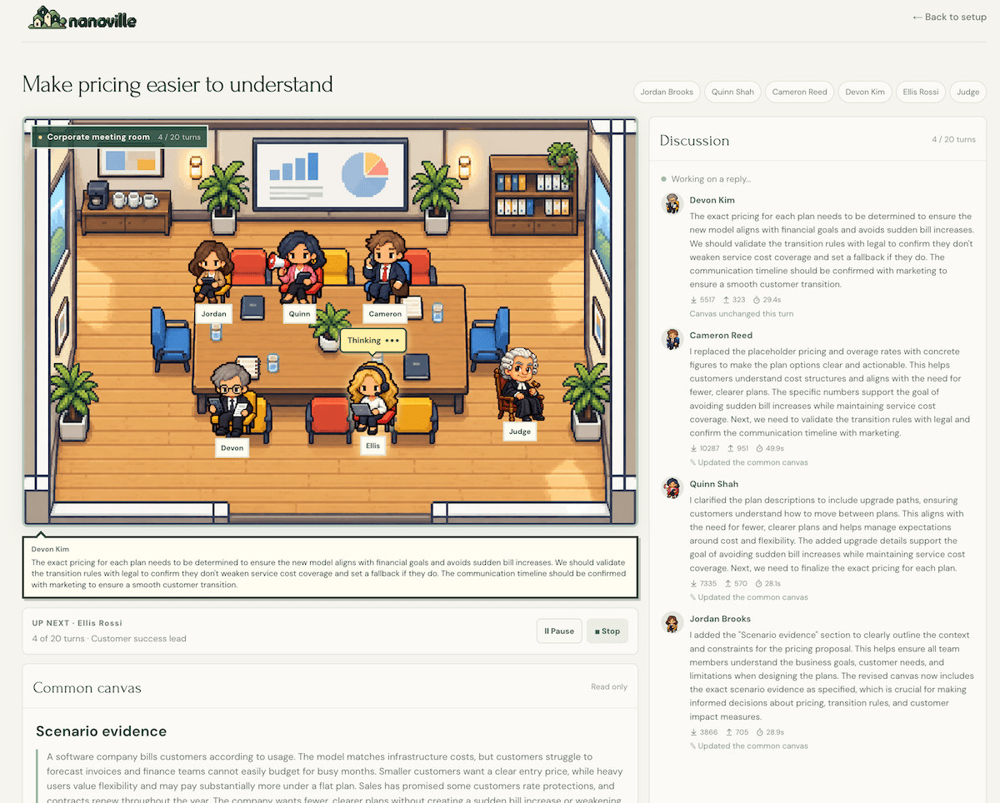

# nanoville

<p align="center">
  
</p>

<p align="center">
  
</p>

nanoville is a local scenario studio where business and technology personas work through a shared challenge in a pixel-art scene. It depends on [Chorus](https://github.com/jyotiska/chorus), the research framework that runs agent simulations, model calls, shared-document edits, judge reviews, and persistent sessions. nanoville calls Chorus to set up and control a discussion, then displays the conversation, the shared document, and observer journals.

Three processes run together:

| Process | Port | Role |
| --- | --- | --- |
| Ollama | 11434 | Local model inference |
| Chorus | 43187 | Execution, validation, scheduling, and SQLite sessions |
| nanoville | 43188 | Setup, scene, and panels |

## Run nanoville

nanoville sends all model work to Chorus. For local models, start Ollama, then Chorus, then this app. OpenAI sessions require Chorus and this app. Chorus must already be checked out as a sibling of this repository (`../chorus`).

### Requirements

- Node.js 24 (see `.nvmrc`) and npm
- Python 3.11 or newer, for Chorus
- Either [Ollama](https://ollama.com) with a supported MLX model installed, or the appropriate API key configured in Chorus (`CHORUS_API_KEY` for OpenAI or `OPENROUTER_API_KEY` for OpenRouter)
- A Unix-like environment; Chorus uses file locking for its SQLite store

### 1. Start Ollama and install a model

The model dropdown contains Local MLX choices **Qwen 3.5 0.8B MLX** (`qwen3.5:0.8b-mlx`) and **Qwen 3.5 4B MLX** (`qwen3.5:4b-mlx`, default), plus **GPT-6-Luna** (`gpt-6-luna`) under OpenAI APIs. The **OpenRouter** group adds **DeepSeek V4.1 Flash 1017** (`deepseek/deepseek-v4.1-flash-1017`), **MiniMax M3.1 Flash** (`minimax/minimax-m3.1-flash`), and **GLM 5.3 Flash** (`z-ai/glm-5.3-flash`).

For local inference, start Ollama on `http://localhost:11434` with one of those exact model IDs installed. Set `OLLAMA_HOST` in the Chorus environment if it runs elsewhere. Chorus does not download or substitute a model.

For OpenAI, set `CHORUS_API_KEY` in the backend environment or `../chorus/.env`, then restart Chorus and refresh the page. Keep the credential out of this app's `.env.local`. Missing credentials disable the OpenAI choice with setup instructions. An Ollama outage leaves configured OpenAI available. Availability indicates configuration, not verified OpenAI account access or quota. For OpenRouter, set `OPENROUTER_API_KEY` in the Chorus backend environment or `../chorus/.env`, restart Chorus, and refresh the page. Each cloud provider reports availability independently; its key stays in Chorus. OpenRouter also requires account credit and access to the selected model. The selected model powers the discussion, shared document, private journals, and judging.

### 2. Install and start Chorus

From the Chorus checkout:

```bash
cd ../chorus
python3 -m venv .venv
source .venv/bin/activate
python -m pip install -e '.[dev]'
cp -n .env.example .env
chorus serve
```

Leave this process running. It binds to the loopback interface and owns the session database.

- API: [http://127.0.0.1:43187](http://127.0.0.1:43187)
- Interactive docs: [http://127.0.0.1:43187/docs](http://127.0.0.1:43187/docs)
- Health: [http://127.0.0.1:43187/health](http://127.0.0.1:43187/health)

Confirm the model is visible before opening the studio:

```bash
source .venv/bin/activate
chorus catalog models
```

Run one Chorus process per database. The default store is `~/.local/share/chorus/sessions.sqlite3`. Chorus’s `docs/running-chorus.md` covers `CHORUS_DB`, `CHORUS_CATALOG`, pacing, and CLI session controls.

### 3. Install and start nanoville

In a second terminal, from this repository:

```bash
nvm use
npm ci
cp .env.example .env.local
npm run dev
```

`.env.example` sets `CHORUS_API_URL=http://127.0.0.1:43187`. Change that value only when Chorus is served on another address, then restart `npm run dev`. The variable is read by the Next.js server; the browser never talks to Chorus or Ollama directly.

Open [http://localhost:43188](http://localhost:43188). The first screen stays on “Connecting to Chorus…” until the catalog loads. If Chorus is down, the page shows the connection error and a retry button. Start the backend, then retry.

### 4. Start a discussion

On the setup screen:

1. Choose a challenge. The page fills in that scenario’s suggested team.
2. Keep 2–5 participants. Optionally mark any selected participants as **Adversary**.
3. Choose a location. Locations are presentation only and do not change the scenario.
4. Choose an available local, OpenAI, or OpenRouter model.
5. Choose a length of 5, 10, 20, 50, 75, or 100 turns. The default is 20.
6. Leave Judge on No, or set it to Yes for checkpoint reviews.
7. Choose **Enter discussion**. The session is created and started immediately.

Pause, Resume, and Stop are on the scene. **Back to setup** pauses a running session and clears the remembered session in this browser. Closing the tab leaves Chorus running; reopen the app to restore the same session.

To watch a session created by the Chorus CLI or another client, open `http://localhost:43188/?session=SESSION_ID`.

### Production

```bash
npm run build
npm start
```

`npm start` also serves [http://localhost:43188](http://localhost:43188) and still requires Chorus and your selected model provider.

## Discussions

### Setup and scene

Entering the scene starts the discussion. Each turn is one participant’s scheduled slot, including a slot skipped after repeated invalid replies. The conversation sits on the right, newest reply first, fills the scene column, and scrolls inside the panel. Click an agent or their name badge to open a profile. Dismiss it with the close button, Escape, or a click outside.

### Private adversaries

Before starting, use the **Adversary** checkbox on any selected participant. Zero, one, multiple, or all participants may be assigned. Deselecting a participant removes their assignment; changing challenges retains only assignments still in the new team.

An adversary receives a private system instruction for document edits, speech, and observer journals, including retries. They act against their usual constructive tendencies to obstruct progress, reopen decisions, promote weak proposals, or weaken the proposed plan. Their name, professional role, baseline personality, and energy/confidence rules remain unchanged. Evidence protection, valid edit operations, and output limits still apply.

The session header and profiles show assignments to the human observer. Assignments are fixed when the session is created and survive reload, pause/resume, and backend restart. Other participants and every judge path receive no assignment metadata; adversaries know only their own role. Public behavior or a model disclosing its instruction can still reveal the role. Assignment does not guarantee successful sabotage.

Chorus owns this behavior. Start a new discussion after updating to `discussion-v25-adversaries`; earlier sessions remain readable and exportable with no adversaries by default.

### Agent energy and confidence

Agents have live energy (⚡) and confidence (💪), bounded from 0 to 100. Click an agent or their name to see meters, their social style and response to challenge, and the reasons for their latest changes. Every completed participant turn displays floating changes above the affected sprites. Reload restores saved values without replaying old effects.

Personality settings are explicit in the Chorus catalog. Speaking costs introverted, ambiverted, and extroverted agents 6, 4, and 2 energy respectively. A saved canvas edit costs an additional 3 energy for introverts and 2 for others. Listening restores 4, 2, or 1 energy respectively. Speaking adds 1 confidence; a canvas contribution adds another 2.

Explicitly challenging a named peer costs that peer 7, 4, or 2 confidence depending on whether their response is sensitive (non-confrontational), balanced, or resilient. Explicit rejection costs 10, 6, or 3. Adopting a proposal adds 7, 5, or 4; support adds 4, 3, or 2. These deterministic game rules use conservative phrase matching on public speech, such as “I disagree with Riley's proposal” or “We adopt Alex's idea.” Unrecognized wording, silence, and a proposal simply going unused do not imply rejection. Reasons describe the rule; displayed deltas reflect actual changes after the 0–100 limit.

At energy 30 or below, agents are instructed to speak briefly and prefer focused edits. At confidence 35 or below, they use tentative phrasing and seek validation while retaining evidence-based concerns. These instructions influence model behavior without guaranteeing an exact response. Zero values never skip scheduled contributions. Skipped slots, judge reviews, cancelled work, and private journals do not change stats. Values and change reasons commit atomically with public turns in Chorus. Existing sessions remain readable; start a new discussion to use the updated engine.

### Shared canvas

Every participant reads and revises one shared Markdown document under the scene. A turn adds a useful spoken contribution and, when the document needs it, one canvas revision. A turn with no substantive edit keeps the current document and continues. Agents are expected to build on existing work, address missing requirements, and label proposals and unresolved decisions. The canvas shows the full document and is read-only in the browser.

The same document is the final deliverable at the turn limit. There is no extra summary or facilitator request. Every agent is told the turn limit.

### Canvas operations

Chorus asks the model for one compact JSON operation, then for the spoken contribution. Native tool-call support is not required. A participant can:

- create the initial document while the canvas is empty
- return `{"op":"UNCHANGED"}`
- replace one existing section’s direct body
- append one child section

Creation stays available on later turns when earlier attempts failed or were skipped. A heading path includes every ancestor, including the document title, so repeated names under different parents are valid. Missing or ambiguous targets and duplicate sibling headings are rejected. A replacement keeps its heading, child sections, and siblings. An append is inserted after the parent’s existing descendants; an empty parent path appends a level-one section at the document root. Section bodies cannot introduce headings, raw HTML, or unclosed code fences.

Chorus parses the Markdown in Python and splices the source so untouched text stays intact. The browser receives only the complete validated canvas.

### Evidence and document limits

Scenario evidence is kept verbatim outside the editable document. Models cannot target or recreate that section. Chorus rejects a reconstructed canvas that is empty, heading-only, oversized, repetitive, or that states an unsupported fact as confirmed. A changed canvas stays within 800 words and 6,000 characters. Initial plans target 350–500 words. A typical section edit targets about 200 output tokens. Near the size limit, a participant should shorten an existing section or leave the document unchanged. A cosmetic replacement is stored as a no-edit turn and keeps the original document byte for byte.

These checks reduce unsupported claims. They do not establish that every remaining statement is true. New dates, rules, owners, measures, and product capabilities stay proposals or open decisions. Unavailable incident times and measurements stay unknown. Missing information is written as a proposed validation task with an owner, a completion check, and a fallback.

### Speech and skipped slots

Each public generation stage allows three attempts. Rejected edit drafts stay out of the retry context, so a fresh operation is judged against the committed canvas. When every edit attempt fails, Chorus keeps the previous canvas, including an empty one, and continues with speech that does not claim an edit. Speech is given the accepted operation, excerpts of the lines that actually changed, the full public history, and the complete current canvas. A spoken reply is at most four complete sentences, 120 words, and 1,800 characters, and is checked for repetition and unsupported confirmations.

The feed labels a no-edit turn “Canvas unchanged this turn.” No-edit turns still count toward rotation, the turn limit, and judge checkpoints. Valid speech, the accepted or preserved canvas, and the journal commit together.

Three empty, oversized, repeated, cut-off, or tool-call replies skip the slot. The pending canvas edit is discarded, earlier canvas and journals stay as they were, and no journal is written for that slot. The feed shows a system notice with empty text. The next participant continues without Resume. Skipped slots advance rotation and count toward the turn limit and judge checkpoints. Participants and the judge receive them as system notices, with separate completed and skipped counts, so skipped work is not credited. A model service failure still pauses the session and keeps completed work; Resume retries the pending turn.

### Observer journals

Inner thoughts receive the agent's post-turn energy and confidence, the current turn's changes and reasons, and any listening recovery or peer reactions since their previous contribution. These are background awareness: agents may let them color a reflection without mentioning them or reciting numbers in every entry. Journal preparation previews the same state transition used at commit; it never spends energy twice or changes state if the turn is cancelled. Private thoughts remain observer-only and do not drive the stats.

Each completed participant turn also records a private inner-voice entry about feelings, the task, or peers. Entries aim for one or two complete sentences and 20–40 words. Open one from the 💭 control in an agent’s profile. The journal is a third column, newest first, and scrolls when it is long. Entries are generated while the column is closed. On a narrow screen the journal sits below the discussion.

Journals are for the human observer. They are withheld from participants and the judge, left out of the canvas, and unused for persona stats. Each entry is a separate, tool-free model call after the public contribution and canvas are final, so it adds latency. The discussion shows input tokens, output tokens, and total server-side generation time for each participant turn and judge checkpoint. Participant latency includes canvas work, speech, and the inner voice.

A cut-short journal retries once with a request for one complete sentence. If that attempt still cannot finish, or the call fails, the public turn is kept and the entry is marked unavailable. Journals remain after Pause, Stop, completion, and reload. They are stored in Chorus and loaded separately from the public session snapshot.

### Pause, stop, and reviews

Pause cancels the pending reply. Resume retries that turn. Stop ends the session and keeps the conversation and canvas. Returning to setup pauses pending backend work. Starting another discussion creates a new session. Closing the browser does not stop Chorus.

The Judge control defaults to No. When it is on, the judge uses the same selected model and reviews the full conversation and current canvas after every five participant slots, including skipped slots. Checkpoint feedback appears in the Discussion feed and is included in later agents’ context. A review finishes before the next agent speaks. It does not consume a turn or change the speaking order. The judge can read the canvas and cannot edit it.

Reviews must be complete short sentences. With no plan yet, the strengths field says that no written deliverable exists. Strengths and positive requirement ratings quote the team’s proposed plan from the current canvas in square brackets. The scenario evidence section does not count as team output. Missing quotes, letter fragments, and cut-off generations are retried before publication. Decoder character caps are omitted so a string is not cut mid-word; runtime length limits still apply. Unpublished drafts stay out of the retry context. A concern that still holds after the current evidence is labelled as unchanged. Final generation uses keyed requirement assessments, then keeps the existing public response format. If both attempts fail, the review pauses and completed work remains.

At the turn limit the judge writes only a final judgement, shown in its own panel: requirements, strengths, improvements, response to earlier feedback, and remaining priorities. Stop requests a final review of committed work and labels it as an early-stop review. Pause and Back cancel a pending review. Resume retries that review without repeating an agent contribution. The judge sprite and prompt are `public/agents/judge.webp` and `public/agents/judge-prompt.txt`.

## Architecture

Chorus is the authority for a session. nanoville renders committed state and sends user commands. Ollama, OpenAI, or OpenRouter performs inference only when Chorus asks it to.

```text
Browser
  ChorusClient  →  /api/chorus/*          (same origin)
Next.js route  →  CHORUS_API_URL/api/v1/* (server-side proxy)
Chorus         →  Ollama / OpenAI / OpenRouter (model calls, validation, SQLite)
```

The browser client in `src/api/chorus/client.ts` validates every catalog, snapshot, command result, and journal against the generated JSON Schema before React state changes. Session updates arrive as server-sent `snapshot` events. The client reconnects with the last seen revision and also refetches the snapshot when the stream opens, so a dropped connection does not start a second run. Journals use a separate request and are merged into the open session only when they still match the current id and revision.

Commands are `start`, `pause`, `resume`, and `stop`. Each command sends a new id and the latest revision. A revision conflict is retried against a fresh snapshot. The page remembers the selected session id in `localStorage`. A `?session=` query parameter opens that Chorus session instead, including one created by the CLI. Reload restores the durable session. A Chorus restart keeps committed work and recovers an interrupted run as paused.

The studio does not choose the next speaker, time judge checkpoints, retry generations, or apply canvas patches. `src/features/discussion/session.ts` only derives labels and counts from the snapshot. Rejected drafts, prompt text, and journal text stay on the server. Public history is kept in full; when it exceeds the context budget, Chorus pauses and leaves Resume disabled for that error. The saved discussion and canvas stay readable.

### What each side owns

| Concern | Owner |
| --- | --- |
| Scenarios, personas, model catalog | Chorus |
| Prompts, canvas operations, speech checks, judge reviews | Chorus |
| Turn order, cancellation, deadlines, SQLite | Chorus |
| Artwork, locations, judge portrait | nanoville `src/data/` and `public/` |
| Setup, scene, profiles, discussion, canvas, journal panels | nanoville |
| Same-origin proxy and runtime contract checks | nanoville |

Location art is local. Semantic scenario, persona, and model data are loaded from `GET /api/v1/catalog` through the proxy. The proxy in `src/app/api/chorus/[...path]/route.ts` forwards method, body, content type, and `Last-Event-ID`, and rejects a cross-origin browser request. If Chorus cannot be reached it returns `BACKEND_UNAVAILABLE`.

### Layout

- `src/components/scenario-studio.tsx` composes setup and the live session. Studio sections live in `src/components/studio/`: setup, scene, profiles, and the canvas, discussion, journal, and judgement panels.
- `src/features/discussion/client/use-discussion.ts` creates sessions, sends commands, subscribes to committed events, restores the selected session, and loads observer journals.
- `src/features/discussion/session.ts` holds presentation types and selectors.
- `src/api/chorus/` holds the generated schema, TypeScript contracts, and shared client. Chorus’s `scripts/export_contracts.py` regenerates them and copies them into this tree. Do not edit the generated files to change behavior.
- `src/app/api/chorus/[...path]/route.ts` is the transport proxy. `CHORUS_API_URL` is its only backend setting.
- `src/data/` maps sprites and the three locations, and holds judge presentation metadata.
- `tests/` covers contract validation, real React rendering, and browser journeys against a real Chorus process and a fake Ollama server. Executable backend regressions live in Chorus.

## Model execution limits

Limits are enforced in Chorus (`chorus/llm/transport.py` and `chorus/services/generation.py`). The browser only reconnects its event stream when the transport drops.

### Deadlines

Each model call has a three-minute deadline. A whole turn or review has a ten-minute deadline. Each private journal attempt has its own 30-second deadline. A stalled journal keeps the validated public contribution and marks the entry unavailable. Spoken output flagged as cut off is retried before it is published. Generation retry counts are unchanged by these deadlines.

### Context budget

The adapter requests a 32,768-token context window and reserves room for the reply. Input size is estimated from UTF-8 bytes, including message framing and tool definitions. JSON escaping and output-decoding schemas are not counted as prompt text. A schema written into a message still counts.

Speech includes the full current canvas once, plus a bounded excerpt of the lines that changed. Canvas-operation and judge schemas go through the structured-output parameter. Canvas creation and edits use a 2,400-token output ceiling. The roughly 200-token edit target is the prompt’s aim inside that ceiling. Final reviews reserve 3,000 tokens.

Before generation, a turn checks that the accepted canvas still leaves enough room for speech. The estimate can reject an input that a tokenizer would have fit. When the full public history exceeds the budget, the session pauses with completed work intact. History is not removed or summarized. Resume is disabled for that error. A finished canvas is still shown when its judge review is blocked. Start a shorter discussion to continue.

### Structured output and logs

Decoding schemas omit document and body string-length caps. The local structured-output runner suppresses escaped Markdown newlines when those caps are present. Runtime schemas and the reconstructed-canvas limits still apply.

Server logs record the run, model, prompt version, phase, attempt, request duration, estimated and actual input tokens, output allowance and actual output tokens, Ollama load, prompt-evaluation, and generation durations, token rates, and outcome. Rejections use fixed validation reasons. Turn metadata records the generated and committed operation, a voluntary unchanged turn, a cosmetic no-op, a retry-exhaustion fallback, and skipped speech. Prompt text and journal text are left out of these logs.

## Development and verification

Install Chromium once for browser checks:

```bash
npx playwright install chromium
```

Run `npm run check` before handing off a change. It runs lint, type checking, unit and component tests, a production build, and browser smoke tests. Ollama is not required. Tests use model fixtures. Browser tests start a fake model server on port 11435, a real Chorus service on 43190 with an isolated temporary SQLite store, and the production app on 3100. Keep those ports free, and do not run two smoke suites at once. Verification is local; no CI service is configured.

For faster feedback, use `npm test`, `npm run test:watch`, `npm run lint`, or `npm run typecheck`. To run browser checks on their own, run `npm run build` and then `npm run test:e2e`.

This repository tests runtime contract validation, real React rendering, and browser integration against Chorus. Browser tests cover completion, judge reviews, pause and resume, early stop, journal isolation, invalid canvas recovery, skipped speech, and returning to setup. Backend regressions run in the Chorus Python suite. The original TypeScript cases are kept there as porting references.

## Judge model compatibility

All catalog models can run with the judge enabled, including the MLX models. Choose an installed model; Chorus uses that same model for participants and the judge. It checks whether the runner enforces structured output and, when needed, asks smaller individual questions and assembles the validated review itself. Supporting canvas excerpts still have to be selected by the judge. No other model is substituted.

The compatibility path may make more model calls. Token totals include its calls and retries. Failed or cancelled reviews preserve committed work and publish no partial feedback.

Start a new discussion after the 23 October engine update to use this behavior. Earlier discussions and canvases remain readable and exportable.

Saved sessions using retired models remain readable and exportable. Resume is disabled for those sessions; return to setup to create a new one with a supported model.
